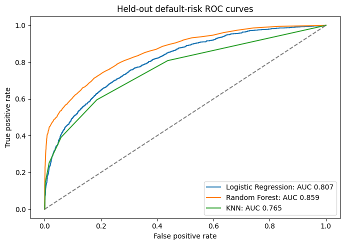
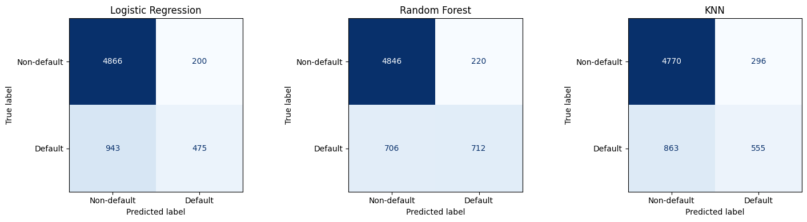

# Credit Default Prediction and Credit Modelling

Predict loan default from borrower and loan characteristics, compare classifiers with training-only preprocessing, and evaluate their performance on an untouched test set.

The main project is **loan-default prediction**. Two separate demonstrations cover numerical credit-score regression and loan approval. The executed notebook includes saved tables, plots and example predictions.

[Open the notebook](./credit_default_prediction.ipynb) | [Run in Google Colab](https://colab.research.google.com/github/pavanpani086/projects/blob/main/credit-default/credit_default_prediction.ipynb) | [Detailed methods](./docs/DATA_AND_METHODS.md)

## Main result

Random Forest was selected using the highest **mean training-CV ROC-AUC (0.8511)**. On the **6,484-record held-out test set**, it achieved:

| Metric | Recorded result |
|---|---:|
| ROC-AUC | **0.8585** |
| Accuracy | **85.72%** |
| Default-class precision | **76.39%** |
| Default-class recall | **50.21%** |
| Default-class F1 | **0.6060** |
| Average precision | 0.7234 |
| Brier score | 0.1060 |

Precision, recall and F1 refer to **default = 1**, at a classification threshold of **0.5**. Accuracy is reported alongside default recall and ranking metrics because the classes are imbalanced.

## Workflow

1. Restore the three bundled CSV datasets and verify their checksums.
2. Inspect missing values and data quality, then remove exact duplicate default-risk rows.
3. Make one stratified 80:20 default-risk split: **25,932 training** and **6,484 test** records.
4. Analyze training-set loan-to-income patterns and default rates by loan intent.
5. Fit median/mode imputation, numeric scaling and one-hot encoding inside each model pipeline and each CV fold.
6. Compare Logistic Regression, Random Forest and KNN on the same **five stratified training folds**; select by mean CV ROC-AUC.
7. Evaluate the selected and comparison models on the common test set; inspect ROC curves, confusion matrices and Random Forest feature importance.
8. Predict for individual applicants through the same fitted preprocessing pipelines and save the models, metrics and prediction CSVs.
9. Run the separate credit-score and loan-approval demonstrations, with an optional three-tab Gradio interface.

## Held-out classifier comparison

| Model | Accuracy | Default precision | Default recall | Default F1 | ROC-AUC |
|---|---:|---:|---:|---:|---:|
| Logistic Regression | 82.37% | 70.37% | 33.50% | 0.4539 | 0.8070 |
| **Random Forest** | **85.72%** | **76.39%** | **50.21%** | **0.6060** | **0.8585** |
| KNN | 82.13% | 65.22% | 39.14% | 0.4892 | 0.7646 |
| Majority baseline | 78.13% | 0.00% | 0.00% | 0.0000 | 0.5000 |

These values come from the saved notebook outputs. The static CSV/JSON summaries retain the displayed rounding; running the notebook regenerates full-precision exports.





## Related demonstrations

| Task | Method | Recorded held-out result |
|---|---|---|
| Predict the dataset's numerical credit score | Decision Tree Regressor | MAE 35.3250; RMSE 48.5581; R² 0.4060 |
| Predict Approved/Denied | MLP with hidden layers (50, 25), training-only SMOTE | Accuracy 84.62% on 13 test rows |

These tasks use different datasets and targets. The approval dataset has **61 rows**, so its score is a small-sample demonstration. The numerical score is the dataset's supplied target, rather than a verified bureau score. Neither result should be presented as the default classifier's performance.

## Run the project

### Google Colab

1. Open `credit_default_prediction.ipynb` in Colab using the link above, or upload the notebook to Colab.
2. Select **Runtime > Run all**.
3. The data cell restores all three CSV files; no separate data upload or Kaggle login is needed.
4. Results and model files are written to `course_credit_outputs/` in the runtime. Download that folder if you want to retain a new run's artifacts.

### Local Jupyter

Use **Python 3.12**, matching the notebook's recorded Python version. Open a terminal in this project folder:

```bash
python -m venv .venv
```

Activate the environment on Windows:

```powershell
.venv\Scripts\Activate.ps1
```

Or on macOS/Linux:

```bash
source .venv/bin/activate
```

Install dependencies and start Jupyter:

```bash
python -m pip install -r requirements.txt jupyterlab
python -m jupyterlab credit_default_prediction.ipynb
```

Select the notebook's Python kernel and run all cells in order. The notebook's setup cell also installs imbalanced-learn if a working installation is missing.

### Optional Gradio interface

The default run leaves the interface switched off. For the three prediction tabs:

1. Run the training/evaluation cells first.
2. Install the optional dependencies with `python -m pip install -r requirements-demo.txt`, or let the notebook's interface builder install them.
3. Set `LAUNCH_GRADIO = True` in the final code cell and run it.
4. Use `SHARE_DEMO = False` locally. Colab may require `SHARE_DEMO = True`, which creates a temporary public demo URL.

The tabs cover default risk, the supplied numerical credit score, and the small-sample approval demonstration. Launching the interface does not retrain the models.

## Files

| Path | Contents |
|---|---|
| `credit_default_prediction.ipynb` | Complete executed implementation, bundled data and saved outputs |
| `requirements.txt` | Core dependencies; pins the three versions printed by the saved run |
| `requirements-demo.txt` | Optional Gradio dependencies |
| `results/` | Tables and six figures extracted directly from the saved notebook outputs |
| `docs/DATA_AND_METHODS.md` | Features, modelling choices, datasets and interpretation |
| `docs/COURSE_RESOURCE_MAP.md` | Mapping from the 12 supplied course scripts to the combined notebook |
| `.gitignore` | Excludes local environments, restored data and generated model/output files |

The original 12 scripts are represented in the combined notebook and are not separate runtime dependencies. Running the notebook creates `course_credit_data/` and `course_credit_outputs/`; the latter includes `combined_course_models.joblib`, full-precision metric CSVs and prediction CSVs.

## Source and attribution

Adapted from the instructor-supplied resources for **[Credit Risk Modelling & Credit Scoring with Machine Learning, Christ Raharja](https://www.udemy.com/course/credit-risk-modelling-credit-scoring-with-machine-learning/)**. The twelve parts were combined, with consistent fitted preprocessing, deduplication, shared stratified evaluation, applicant prediction and result exports.

The default-risk and numerical-score CSVs were supplied in the course materials. The small approval dataset is the [Simple Loan Classification Dataset](https://www.kaggle.com/datasets/sujithmandala/simple-loan-classification-dataset) referenced by the supplied MLP script. The notebook preserves the dataset-source notes and bundled-data checksums.
